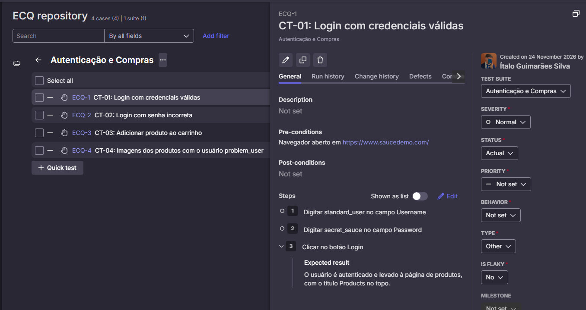
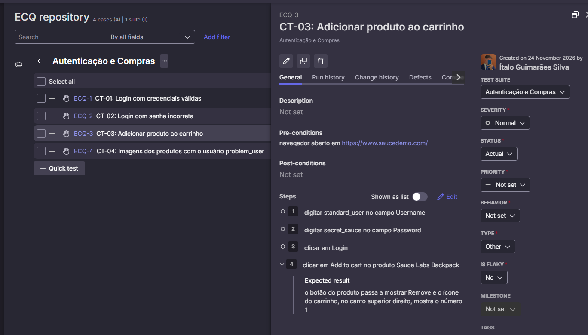
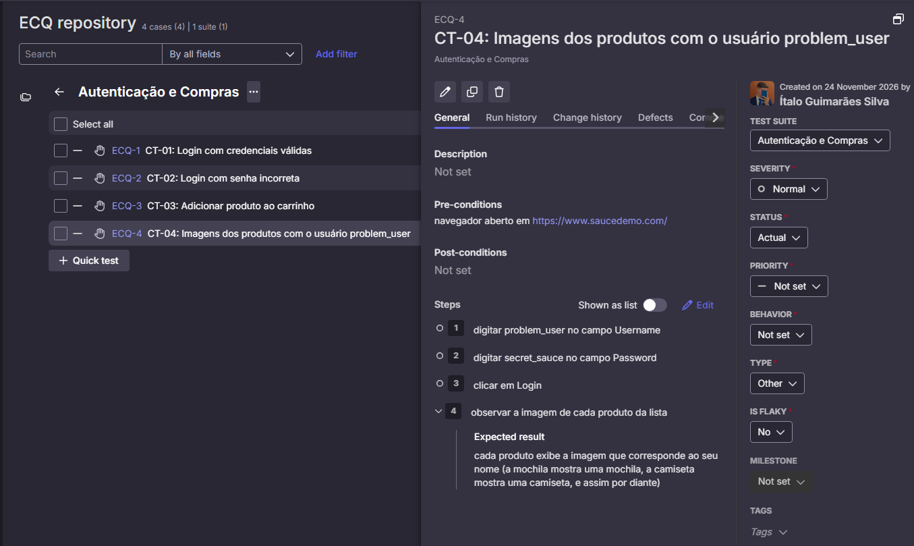

# Atividade: Primeiro Teste de Software
**Estudante:** [seu nome completo]
**Curso e período:** Bacharelado em Sistemas de Informação, 8º período
**Disciplina:** Teste de Software
## Sistema testado
SauceDemo (https://www.saucedemo.com/)
## Classificação do teste realizado
[Resposta da pergunta 5: nível, objetivo, visão do código, execução, modo e motivo,
com uma frase de justificativa em cada]
## Casos de teste

## Execução

## Defeito encontrado
[cole aqui o endereço da sua issue, ex.: https://github.com/seu-usuario/relatorio-debugs-lab/issues/1]
## Respostas às perguntas para refletir
1. [sua resposta]
2. [sua resposta]
3. [sua resposta]
4. [sua resposta]
5. A resposta da pergunta 5 está na seção "Classificação do teste realizado".
6. [sua resposta]
