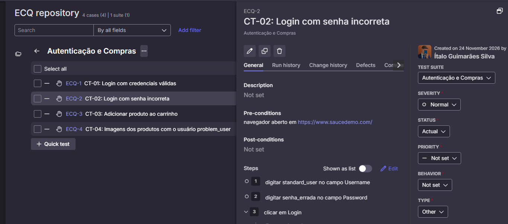
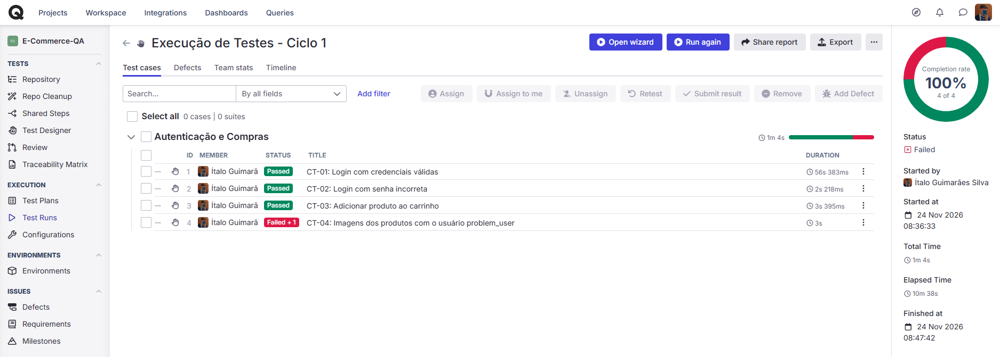

# Atividade: Primeiro Teste de Software
**Estudante:** 
- Ítalo Guimarães Silva (https://github.com/italo-gs)
- Luis Fernando de Oliveira Naves (https://github.com/luisFernandoON)
  
**Curso e período:** Bacharelado em Sistemas de Informação, 8º período
**Disciplina:** Teste de Software
## Sistema testado
SauceDemo (https://www.saucedemo.com/)
## Classificação do teste realizado

- Nível - Sistema, foi simulado o uso de todo o sistema via navegador, como um cliente final faria
- Objetivo - Funcional, para atestar se a loja realiza a função planejada corretamente
- Visão do código - Caixa-Preta, Sem acesso ao código fonte, averiguamos apenas as telas e os resultados gerados.
- Execução - Dinâmico, o sistema foi acessado e utilizado
- Modo - Manual, cada passo executado por um agente humano
- Motivo - Teste novo, foi executado pela primeira vez
  
## Casos de teste

## Execução

## Defeito encontrado
[cole aqui o endereço da sua issue, ex.: https://github.com/seu-usuario/relatorio-debugs-lab/issues/1]
## Respostas às perguntas para refletir
1. Por que o resultado esperado é escrito antes de executar o teste?
>Para evitar no ato do teste, a interpretação de um defeito como um função proposital.

2. [sua resposta]
3. Quatro casos passaram ou falharam. Podemos afirmar que a loja não tem mais
nenhum defeito além do que você encontrou? Justifique.
>Apenas 3 casos de testes passaram. Não posso afirmar que a loja só tem apenas 1 defeito, pois os meus casos de teste não chegou a testar outras áreas que possa apresentar defeitos ou não.

4. Se essa loja fosse da sua empresa, o que você testaria a seguir?
>Realizaria dois testes adicionais:
>- Validação das informações apresentadas ao clicar em um produto para mais detalhes sobre.
>- Teste do botão de Remoção, se ele remove o item do carrinho ou não.
  
5. A resposta da pergunta 5 está na seção "Classificação do teste realizado".
6. [sua resposta]
